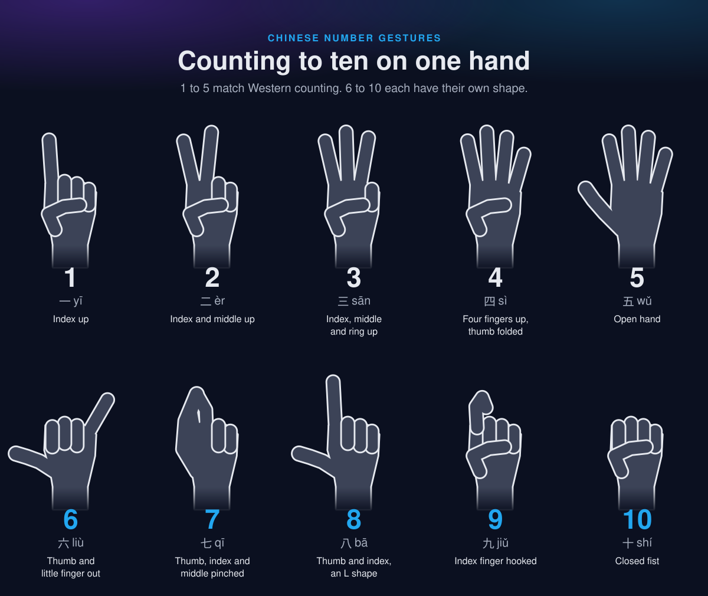

# yishou 一手

[](https://yishou.sparkup.dev/)
[](https://github.com/sparkup/yishou/actions/workflows/ci.yml)
[](https://huggingface.co/dworsleytonks/yishou)
[](LICENSE)

Count from 1 to 10 on one hand, and have a webcam read it back.

### 👉 [Try the live demo at yishou.sparkup.dev](https://yishou.sparkup.dev/)

It runs entirely in your browser, with nothing to install, and no image ever leaves your device.

> [!NOTE]
> This branch adds a thumb, which the demo reads as thumb up or thumb down. It is the example from [Add your own gesture](#add-your-own-gesture) applied, and its model is on the `thumbs` branch of the [Hugging Face repo](https://huggingface.co/dworsleytonks/yishou/tree/thumbs).

In the West, one hand counts to five. In China, one hand counts to ten, because the numbers 6 to 10 each have their own hand shape. This project trains a small classifier to recognise all ten from a webcam feed and show the number on screen.

## Why this project

I wanted to know whether a model could learn the Chinese number shapes, and how far a small, home-made dataset would get. MediaPipe already finds the 21 points of the hand, so the work is in what each shape means. The French 2 (thumb and index) is the Chinese 8, for example, so the model has to learn a convention rather than count fingers.

一手 (yī shǒu) means "one hand". In Chinese, 露一手 (lòu yī shǒu) also means "to show what you can do".

## The gestures



| Number | Hand shape                                          |
| ------ | --------------------------------------------------- |
| 1      | Index finger up                                     |
| 2      | Index and middle fingers up                         |
| 3      | Index, middle and ring fingers up                   |
| 4      | Four fingers up, thumb folded                       |
| 5      | Open hand                                           |
| 6      | Thumb and little finger out, others folded          |
| 7      | Thumb, index and middle fingertips pinched together |
| 8      | Thumb and index finger out in an L shape            |
| 9      | Index finger hooked, others folded                  |
| 10     | Closed fist, or index and middle fingers crossed    |

These follow the most common mainland Chinese convention. Some numbers have regional variants, and the model learns whichever variant it is shown. It knows two of them, each recorded as extra examples of the same number.

- **3, the German way.** Thumb, index and middle finger, as well as the Chinese index, middle and ring
- **10, crossed fingers.** Index and middle fingers crossed into the shape of 十, the character for ten. Some regions of China use it instead of the fist, as a reader of my LinkedIn post pointed out

The French 2 (thumb and index) could not go in the same way, because it is the same hand shape as the Chinese 8 and the model has no way to tell which one you mean.

### Easter eggs

The live demo also hides two hand signs that are not numbers. Each has its own class, so the model does not mistake the rock sign for 6 or the OK sign for 3.

| Sign    | Hand shape                                                                            |
| ------- | ------------------------------------------------------------------------------------- |
| rock 🤘 | Index and little finger up, in two variants, thumb folded over the others or held out |
| OK 👌   | Thumb and index fingertips touching in a circle, other three fingers up               |

Try them in the [live demo](https://yishou.sparkup.dev/).

## How it works

```
webcam frame -> MediaPipe hand landmarks -> normalised features -> MLP -> number
```

1. **Tracking.** MediaPipe finds 21 landmarks on the hand in each frame.
2. **Features.** The landmarks are normalised so that only the shape of the hand is left. The wrist moves to the origin, the palm is scaled to length 1 and rotated to point up, and left hands are mirrored into right hands. That gives 63 numbers per frame.
3. **Classifier.** A small PyTorch MLP maps those 63 numbers to one of 13 classes, the ten numbers, "none" for any other hand shape, and the two Easter eggs.
4. **Smoothing.** The demo averages the class probabilities over the last seven frames, so the number on screen does not flicker and the confidence bar always belongs to the number shown.

The classifier never sees pixels, so it is tiny, trains in seconds on a CPU, and does not depend on lighting or background.

## Results

The published model reads **97.5%** of validation frames correctly. They are 4,990 frames from recordings held out whole, with 9,495 frames left for training.

| Gesture  | none | 1    | 2    | 3   | 4    | 5    | 6    | 7   | 8    | 9   | 10  | rock | OK   |
| -------- | ---- | ---- | ---- | --- | ---- | ---- | ---- | --- | ---- | --- | --- | ---- | ---- |
| Accuracy | 100% | 100% | 100% | 92% | 100% | 100% | 100% | 98% | 100% | 89% | 90% | 100% | 100% |

Most of the misses come from a few pairs of shapes. The hooked index of 9 is sometimes read as a fist, the crossed 10 as 2, 3 as 7, and 7 as 2. In each case fingers fold, cross or bunch together, which is where the 21 landmarks are least reliable.

These numbers come from my own hand, so they are an upper bound. `yishou evaluate` (below) measures the model on someone else's.

## Setup

Requires Python 3.11 or 3.12 and [uv](https://docs.astral.sh/uv/).

```bash
git clone https://github.com/sparkup/yishou.git
cd yishou
uv sync
```

The first run downloads MediaPipe's hand landmark model (about 8 MB) to `~/.cache/yishou`.

On macOS, the terminal you run from needs camera access, under System Settings > Privacy & Security > Camera.

## Usage

### Try the pretrained model

A model trained on my own recordings is published on [Hugging Face](https://huggingface.co/dworsleytonks/yishou), so you can run the demo straight after setup.

```bash
uv run yishou demo --model dworsleytonks/yishou
```

It has only seen my hands, so it works best once you have recorded and trained your own. About five bursts of five seconds per gesture is enough for a first model. To measure how the published model does on your hand first, see [step 3](#3-test-it-on-someone-elses-hand).

### 1. Record samples

```bash
uv run yishou collect
```

| Key        | Action                  |
| ---------- | ----------------------- |
| `1` to `9` | Select that number      |
| `0`        | Select ten              |
| `n`        | Select "none"           |
| `r`        | Select the rock sign    |
| `o`        | Select the OK sign      |
| `t`        | Select the thumb        |
| `space`    | Start or stop recording |
| `q`        | Quit                    |

Keys only reach the program while the video window has focus. Select a gesture, hold it up, and press space to record. While recording, move your hand around the frame, closer and further away, and tilt it. Record each gesture in several short bursts rather than one long one, and record "none" with a mix of other hand shapes. Samples are appended to `data/samples.csv`, which stays out of git.

### 2. Train

```bash
uv run yishou train
```

Prints validation accuracy and a confusion matrix, and saves the model to `models/latest`.

Validation holds out whole recording bursts. Consecutive webcam frames are nearly identical, so a random split would test the model on near-copies of its training data.

### 3. Test it on someone else's hand

```bash
uv run yishou collect --data data/alex.csv
uv run yishou evaluate data/alex.csv
uv run yishou evaluate data/alex.csv --model dworsleytonks/yishou
```

Record a few bursts of each gesture from someone the model has never seen, then score any model on them. It prints the accuracy, the confusion matrix and the three weakest gestures. This is the number to trust, because validation during training only holds out recordings of the same person.

### 4. Run the demo

```bash
uv run yishou demo
uv run yishou demo --record demo.mp4    # also save the preview as a video
```

### 5. Publish to Hugging Face

```bash
uv run hf auth login
uv run yishou push your-username/yishou
```

This uploads the model with a generated model card, which lists the validation accuracy of each gesture. Anyone can then run it with `yishou demo --model your-username/yishou`.

## Add your own gesture

The vocabulary lives in [`src/yishou/gestures.py`](src/yishou/gestures.py), so adding a gesture takes three lines of code and a new recording. Thumbs up and thumbs down make a good example, for instance to let viewers vote with their hand during a live.

### 1. Declare it

Give it the next free number, a name and a key to select it while recording.

```python
# At the top of gestures.py
from yishou.features import THUMB

# At the end of GESTURES
    Gesture(13, "thumb", "Thumb out, other fingers folded", pointer=THUMB),

# At the end of KEY_TO_LABEL
    "t": 13,
```

The features ignore how the hand is rotated, so that a 3 is still a 3 when the hand is tilted. That also means the model cannot tell a thumb up from a thumb down, and `pointer=THUMB` is there for that. The model learns a single "thumb" class, and the demo reads which way the thumb points from the raw landmarks and shows "thumb up" or "thumb down". `INDEX` works the same way, for a finger pointing left or right.

### 2. Record it

Run `uv run yishou collect`, press `t`, hold your thumb up and press space to record. Move your hand around, closer and further away, then press space again to stop. Do the same with your thumb down, under the same key, and with your other hand. Five or six short bursts in each direction are enough to start.

The published model has never seen the new gesture, so you train your own, and it needs the other gestures too. If you have not recorded them yet, record them in the same session, as described in [Record samples](#1-record-samples).

### 3. Train and try it

```bash
uv run yishou train
uv run yishou demo
```

The confusion matrix printed by `train` shows whether the new gesture gets mixed up with an existing one. A fist with the thumb out is close to 10, for instance. If it is, record a few more bursts of both.

### Or start from a clean slate

If you only need a few gestures, a vote for instance, keep just those. Leave "none" and your own gestures in `GESTURES`, numbered from 0 in order, give each one a key in `KEY_TO_LABEL`, and record into a new file.

```python
GESTURES = (
    Gesture(0, "none", "Any hand shape that is not a vote"),
    Gesture(1, "thumb", "Thumb out, other fingers folded", pointer=THUMB),
)

KEY_TO_LABEL = {"n": 0, "t": 1}
```

```bash
uv run yishou collect --data data/vote.csv
uv run yishou train --data data/vote.csv
uv run yishou demo
```

A model with fewer classes has fewer ways to get confused, and needs a lot less recording.

### A ready-made example

The [`thumbs` branch](https://github.com/sparkup/yishou/tree/thumbs) is this guide applied to the full model, with all the gestures plus the thumb. Its trained model is on the `thumbs` branch of the Hugging Face repo, so you can try it without recording anything.

```bash
git checkout thumbs
uv run yishou demo --model dworsleytonks/yishou --revision thumbs
```

## Limitations

> [!WARNING]
> **Model limitations.** The model I trained learnt from a very small dataset, about 14,500 webcam frames recorded by one person. Making it reliable would take more than data. Someone would have to decide which counting conventions to prioritise, and how to handle shapes that mean different numbers in different countries, such as the French 2 and the Chinese 8 above.

This is a learning project. The model has seen one person's hands, on one webcam, in one room, so it will do worse on anyone else. A model meant for real use would need a dataset built very differently.

- **Count people, not frames.** A webcam gives 30 near-identical frames a second, so a million frames from a handful of people teaches less than a few thousand frames from thousands of people
- **Cover the people who will use it.** Ages from children to older adults, the full range of skin tones (MediaPipe has to find the hand before the classifier sees anything, so its detection rate needs checking per group too), left and right hands, and hands that differ, with missing or stiff fingers, arthritis or rings
- **Cover the conditions it will run in.** Phones and laptops, daylight and dim rooms, busy backgrounds, different distances and angles, and moving hands with motion blur
- **Collect it properly.** Informed consent, since hand images can count as personal data under the GDPR. Run MediaPipe on the participant's device and keep only the 21 landmarks, never the video
- **Test it fairly.** Split by person, and report accuracy for each group rather than one overall number, because a good average can hide a group it fails. `yishou evaluate` is a start, one person at a time

## Development

```bash
uv run pytest
uv run ruff check .
uv run ruff format .
```

The tests use synthetic hands, so they need no webcam and no recorded data.

## Project layout

```
src/yishou/
  gestures.py   The gesture vocabulary
  features.py   Landmark normalisation
  tracking.py   Webcam frames and MediaPipe hand tracking
  overlay.py    Drawing on the preview window
  dataset.py    Sample storage and the burst-based train/validation split
  collect.py    Sample recording
  model.py      The MLP
  train.py      Training loop and evaluation
  evaluate.py   Scoring a model on new recordings
  demo.py       Live demo
  hub.py        Hugging Face publishing
  cli.py        Command line entry point
tests/          Unit tests on synthetic hands
```

## License

[MIT](LICENSE)
